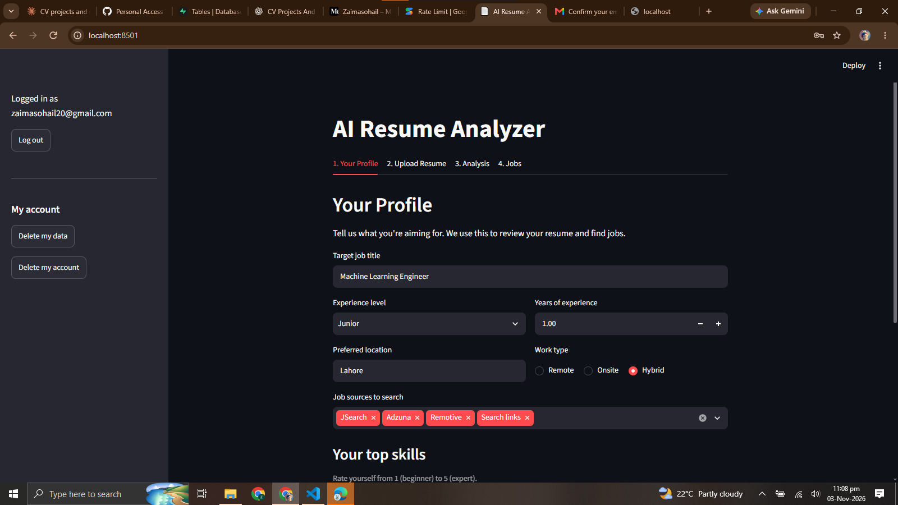
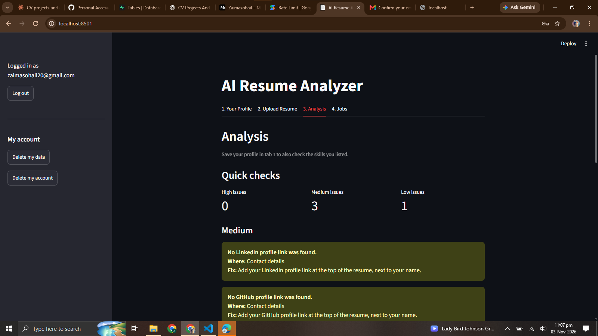
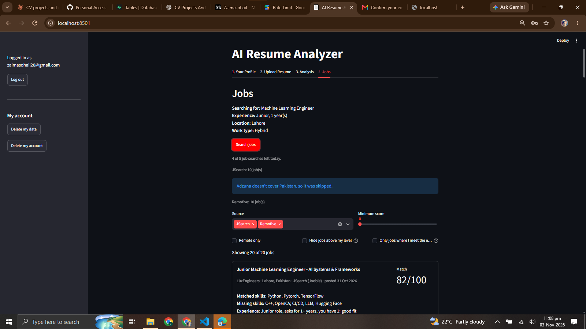

# AI Resume Analyzer

A Streamlit web app that reviews your resume, explains exactly what to fix, and finds jobs that match your skills and experience.

## Features

- **Skills profile**: target role, experience level, years of experience, self-rated skills, location, work type and preferred job sources.
- **Resume parsing**: reads PDF and DOCX files (up to 5 MB), detects sections such as Experience, Skills and Projects, and finds email, phone, LinkedIn and GitHub details. Scanned PDFs get a clear error instead of a crash.
- **Rule checks** (instant, no AI): missing sections or contact details, resume length, bullets without numbers, weak phrases like "responsible for", and skills you claim but never mention. Each issue has a severity, a location and a suggested fix.
- **AI review** with Google Gemini: overall and ATS scores, strengths, problems with fixes, three rewritten bullets and missing keywords. The model is told never to invent experience; unknown numbers become placeholders like `[X%]`.
- **Job matching** across several sources:
  - **JSearch** (postings from LinkedIn, Indeed, Glassdoor and more, via Google for Jobs)
  - **Remotive** (remote jobs)
  - **Adzuna** (19 supported countries)
  - **Search links**: ready-made searches on LinkedIn, Indeed, Glassdoor and Rozee.pk. These are plain links; the app never scrapes these sites.
- **Accounts with Supabase**: sign up and log in; your profile and past analyses are saved to your account.
- **Saved jobs**: bookmark jobs and come back to them later.
- **Daily limits**: 5 job searches and 3 AI reviews per user per day, enforced by the database, to protect the free API quotas.

## How it works

The app has four tabs:

1. **Your Profile**: fill in the questionnaire. It's saved to your account and loaded again when you log in.
2. **Upload Resume**: upload a PDF or DOCX. You see the word count, contact details and detected sections.
3. **Analysis**: rule-check issues grouped by severity, an optional AI review, and your past analyses.
4. **Jobs**: search your chosen sources, filter the ranked results, save jobs, or use the direct search links.

### Job scoring

Each job gets a score from 0 to 100:

```
score = 45 × skills + 20 × title + 20 × experience + 15 × location
```

| Part | What it measures |
|---|---|
| **Skills (45%)** | Your skills (profile ratings plus your resume's Skills section) found in the job, weighted by your 1–5 rating. Soft skills like "Communication" are ignored, and a long skill list never lowers a score. |
| **Title (20%)** | How many words of your target title appear in the job title. Domain words ("machine", "data") count much more than generic role words ("engineer", "analyst"); seniority words are ignored. |
| **Experience (20%)** | The job's level (from its title or description) and required years (e.g. "3+ years") compared with yours. Being short of the required years lowers this part sharply. |
| **Location (15%)** | Full points for a remote job if you want remote, or a job in your city; partial points for the same country. |

Each job card shows its matched skills, up to five missing skills and a short experience note, for example *"Asks for 3+ years, you have 1.5: a bit above your level"*.

## Tech stack

- **Python 3.11+** and **Streamlit** for the UI
- **pdfplumber** and **python-docx** for resume parsing
- **Google Gemini** via the `google-genai` package for the AI review (JSON response mode)
- **Supabase** (Postgres, Auth and Row Level Security) for accounts and saved data
- **requests** for the job APIs, with a 6-hour JSON file cache to save quota
- **pytest** for tests (all external APIs are mocked)

## Security and privacy

- **Row Level Security**: every table has RLS turned on, and every rule checks `auth.uid() = user_id`. The database itself only lets users read and change their own rows, even if the app code had a bug.
- **No resume files are stored**: only the file name, word count, rule-check issues and AI review are saved. The resume file and its full text are never written to the database.
- **Per-user sessions**: Streamlit serves every visitor from one process, so each visitor gets their own Supabase client, kept in their own `st.session_state`. Nothing user-specific is stored in module-level variables.
- **Usage limits users can't reset**: users can only *read* their usage counts. The only way to change them is a database function that can only add 1, and the limits are checked before any API call. If the check fails, the action is blocked.
- **Delete your data**: the sidebar has "Delete my data" (profile, analyses and saved jobs) and "Delete my account" (everything, via a database function that can only delete the calling user). Both ask for confirmation first.
- **Resume text is sent to Gemini**: when you click "Run AI review", your resume text goes to Google's Gemini API. On the free tier, Google may use it to improve its products. The app shows this notice next to the button.
- **Keys stay out of the code**: all keys are read from `.env`, which is git-ignored. The app uses Supabase's public anon key only; the secret service_role key is never used.

## Run it locally

1. **Clone the repository and enter it**

   ```bash
   git clone https://github.com/zaima-20/ai-resume-analyzer.git
   cd ai-resume-analyzer
   ```

2. **Create and activate a virtual environment**

   ```bash
   python -m venv venv
   # Windows
   venv\Scripts\activate
   # macOS / Linux
   source venv/bin/activate
   ```

3. **Install the dependencies**

   ```bash
   pip install -r requirements.txt
   ```

4. **Add your keys**: copy `.env.example` to `.env` and fill in your own values.

   ```bash
   cp .env.example .env      # Windows: copy .env.example .env
   ```

   | Key | Where to get it |
   |---|---|
   | `GEMINI_API_KEY` | [Google AI Studio](https://aistudio.google.com/apikey) (free) |
   | `RAPIDAPI_KEY` | [JSearch on RapidAPI](https://rapidapi.com/letscrape-6bRBa3QguO5/api/jsearch) (free plan) |
   | `ADZUNA_APP_ID`, `ADZUNA_APP_KEY` | [Adzuna developer portal](https://developer.adzuna.com/) (free) |
   | `SUPABASE_URL`, `SUPABASE_KEY` | Your Supabase project → Project Settings → API. Use the **anon / publishable** key, never the service_role key. |

   Remotive needs no key. Any job source without a key is skipped with a warning.

5. **Set up the database**: in your Supabase project, open **SQL Editor → New query**, paste and run [`supabase/schema.sql`](supabase/schema.sql), then do the same with [`supabase/delete_account.sql`](supabase/delete_account.sql). Each should finish with "Success. No rows returned".

6. **Start the app**

   ```bash
   streamlit run app.py
   ```

   It opens at http://localhost:8501. Sign up, confirm your email, and log in.

## Running tests

```bash
pytest
```

The tests mock every external service (Gemini, Supabase, JSearch, Remotive, Adzuna), so they need no keys and make no network calls. To try the pieces on their own, each module also has a small command-line mode, for example:

```bash
python -m src.parser sample_data/sample_resume.docx
python -m src.rule_checks sample_data/sample_resume.docx
```

## Screenshots

**Profile**



**Analysis**



**Jobs**



## Credits

- Remote job listings are provided by [Remotive](https://remotive.com). Every Remotive job in the app links back to its original posting on Remotive and is marked "via Remotive".
- Job data also comes from [JSearch](https://rapidapi.com/letscrape-6bRBa3QguO5/api/jsearch) and [Adzuna](https://www.adzuna.com).
- AI review powered by [Google Gemini](https://ai.google.dev/).
